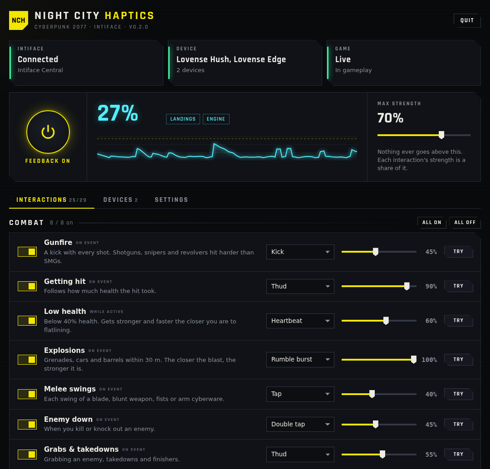

# Night City Haptics

Cyberpunk 2077 for any [Intiface](https://intiface.com)-compatible toy (18+). Hits thud, low
health beats like a heart, explosions and crashes shake, level-ups land, and romance and joytoy
scenes get their own tracks. 47 interactions, each tuned live on a local control page. The busy
ones (gunfire, footsteps, the engine) start off, so the big moments stand out.



## You need

- Cyberpunk 2077 on Windows or Linux / SteamOS, with
  [Cyber Engine Tweaks](https://www.nexusmods.com/cyberpunk2077/mods/107).
- A toy with **Buttplug.io Support** in the [IoST Index](https://iostindex.com/).

Intiface itself is optional: the app downloads the official Intiface Engine for you. If Intiface
Central is already running, it uses that.

## Install

1. Extract [`NightCityHaptics-0.5.1.zip`](dist/NightCityHaptics-0.5.1.zip) into the game folder
   (the one with `bin` in it).
2. Open `bin/x64/plugins/cyber_engine_tweaks/mods/nightCityHaptics/companion/` and run
   **`start.sh`** (Linux) or **`start.cmd`** (Windows). The control page opens in your browser.
3. Click **Download** next to Intiface at the top of the page. The engine starts and scans for
   30 seconds, so turn your toy on. It shows up under Devices.
4. In Steam, open Cyberpunk 2077 → Properties → Launch Options and enter the line for your
   system. From then on the app starts with the game and closes with it.

   **Linux / SteamOS:**

   ```sh
   /bin/sh "/home/deck/.local/share/Steam/steamapps/common/Cyberpunk 2077/nch-steam-launch" -- %command%
   ```

   **Windows:**

   ```bat
   "C:\Program Files (x86)\Steam\steamapps\common\Cyberpunk 2077\bin\x64\plugins\cyber_engine_tweaks\mods\nightCityHaptics\companion\night-city-haptics.exe" --steam -- %command%
   ```

   Change the path if your game is elsewhere (Steam → Manage → Browse local files). Already have
   launch options? Other wrappers go after `--`, game flags after `%command%`, and on Linux
   `VAR=value` settings go first.

The page stays at http://127.0.0.1:19870/ while the app runs. Feedback plays only in live
gameplay, not in menus, loading screens, photo mode or the CET overlay.

## Using it

- **Interactions:** each has a switch, a feel, a strength and **Try**, which previews it
  without the game. Whole groups switch on and off together.
- **Max strength** caps everything (default 70%). **On/Off** stops it all. **Pause** is in the
  CET overlay; Pause and Test buzz can be bound in CET's Bindings.
- **Devices:** strength, battery and a button per output. **Test** sends a short pulse.
- **Settings:** Intiface address (default `ws://127.0.0.1:12345`), engine auto-start and
  **Reset interactions** (keeps device settings).
- **Quit** stops your toys and the engine the app started.

| Output | Behaviour |
|---|---|
| Vibrate, Light | follow the mix |
| Rotate | follows the mix; a sudden hit reverses the spin |
| Thrust | follows the mix |
| Stroke | faster and longer as the mix rises |
| Squeeze | eases toward the mix (off by default) |
| Heat | warms with sustained feedback (off by default) |

## Scenes

- **Romance:** Judy, Kerry, Panam, River and Meredith Stout each have a track. Judy, Kerry and
  Panam have shorter tracks for the censored cut.
- **Joytoys:** Jig-Jig Street and Heywood, synced to each clip.
- Tracks fade out when the scene ends. Loading a save after a romance doesn't replay it.

<details>
<summary>All 47 interactions and their defaults</summary>

Strength is a share of Max strength.

| Group | Interaction | Default |
|---|---|---|
| Combat | Gunfire | 45%, Kick, off |
|  | Getting hit | 90%, Thud |
|  | Low health | 70%, Heartbeat |
|  | Explosions | 100%, Shockwave |
|  | Melee swings | 45%, Kick, off |
|  | Enemy down | 45%, Double tap, off |
|  | Grabs & takedowns | 70%, Thud |
|  | Combat starts | 50%, Alarm |
|  | Charging up | 40%, Rumble, off |
|  | Reloads | 20%, Tap, off |
|  | Weapon overheat | 60%, Rumble burst |
|  | Blocks & parries | 45%, Kick, off |
|  | Grenade throws | 30%, Ramp, off |
|  | Hits landed | 20%, Tap, off |
| Status effects | Burning | 50%, Rumble |
|  | Electrocuted & EMP | 55%, Flutter |
|  | Poisoned & bleeding | 30%, Throb, off |
|  | Knocked down & stunned | 85%, Thud |
|  | Blinded | 60%, Rumble burst |
|  | Relic glitches | 65%, Glitch |
|  | Being hacked | 50%, Static |
| Cyberware | Sandevistan & Kerenzikov | 45%, Wave |
|  | Berserk | 65%, Build |
|  | Quickhack upload | 25%, Flutter, off |
|  | Optical camo | 20%, Wave, off |
| Movement | Sprinting | 20%, Footsteps, off |
|  | Jumps | 30%, Tap, off |
|  | Landings | 55%, Thud, off |
|  | Dodges & slides | 35%, Tap, off |
|  | Climbs & vaults | 30%, Kick, off |
|  | Out of stamina | 35%, Ripple, off |
|  | Running out of air | 50%, Heartbeat |
| Driving | Engine | 25%, Rumble, off |
|  | Crashes | 100%, Shockwave |
|  | Drifting | 45%, Rumble, off |
|  | Gear shifts | 20%, Tap, off |
| Rewards & world | Police heat | 60%, Alarm |
|  | Level up | 85%, Fanfare |
|  | Quest completed | 70%, Fanfare |
|  | Eddies received | 30%, Tap, off |
|  | Healing | 35%, Swell, off |
|  | Loot pickups | 15%, Tap, off |
|  | Incoming calls | 40%, Phone ring |
| Scenes | Romance scenes | 80%, Follow the scene |
|  | Joytoys | 80%, Follow the scene |
|  | Braindances | 30%, Wave, off |
|  | Other mods | 80%, Swell |

</details>

## Troubleshooting

- **Toy not found:** close its phone app and press **Scan**. On Linux, turn Bluetooth on.
- **Permission denied (Linux):** `chmod +x start.sh night-city-haptics` in the companion folder.
- **Logs:** `%LOCALAPPDATA%\NightCityHaptics\` (Windows), `~/.local/share/night-city-haptics/`
  (Linux).

No telemetry, no account. The page only listens on `127.0.0.1`, and the only download is the
Intiface Engine from Intiface's GitHub releases.

## For mod authors

```lua
GetMod("nightCityHaptics").Pulse(0.8, 2)   -- strength 0–1, optional seconds
```

Plays through the **Other mods** interaction.

## Development

Builds both companions and the ZIP from Linux (Rust, `clang`/`lld`, Python 3):

```sh
rustup target add x86_64-unknown-linux-gnu x86_64-pc-windows-msvc
cargo install cargo-xwin --locked
python3 tools/build_native.py
python3 tools/build.py --output-dir .build/candidate
```

Tests (LuaJIT, and `websockets>=15,<17` for the Python tools):

```sh
luajit tests/cet_harness.lua
cargo test --manifest-path rust/Cargo.toml
python3 -m unittest discover -s tests
python3 tools/e2e_intiface.py      # Linux: real Intiface Engine + simulated toy
```

Built on [Buttplug / Intiface](https://buttplug.io)
by Nonpolynomial.
